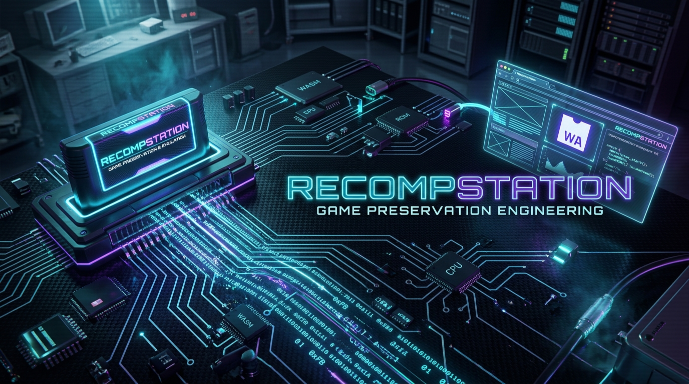

<p align="center">
  
</p>

<h1 align="center">RecompStation</h1>

<p align="center">
  <strong>Next-Generation Static ROM Recompilation, Binary Reverse Engineering & Instant Browser Gaming Platform</strong>
</p>

<p align="center">
  <a href="https://github.com"></a>
  <a href="https://github.com"></a>
  <a href="https://github.com"></a>
  <a href="https://github.com"></a>
  <a href="https://github.com"></a>
  <a href="https://github.com"></a>
  <a href="https://github.com"></a>
</p>

---

## 🧭 Project Philosophy

Traditional emulation treats classic game ROMs as opaque binary blobs, re-interpreting machine instructions on top of virtualized hardware cycles. While versatile, this often introduces execution latency, input lag, micro-stutter, and platform lock-in.

**RecompStation** pioneers a **game preservation engineering philosophy**:

1. **Static Recompilation Over Brute-Force Emulation**: Whenever viable, binary machine code should be analyzed, re-targeted, and statically transformed into native code or modern WebAssembly binaries. This unlocks ultra-high frame rates, true widescreen aspect ratios, frame interpolation, native rendering backends, and deterministic execution.
2. **100% Local-First Sovereignty & Privacy**: Your personal game dumps, ROM backups, and save states belong solely to you. All binary parsing, hashing, entropy analysis, and execution run strictly client-side inside your browser or native desktop sandbox. No ROM binaries are ever uploaded to remote servers.
3. **Reproducible Binary Intelligence**: Every file is systematically cataloged with multi-algorithm cryptographic verification (CRC32, MD5, SHA-1), Shannon information entropy mapping, and multi-architecture instruction disassembly (MOS 6502, Sharp SM83, CHIP-8, MIPS R4300i).
4. **Zero Dark Patterns & Zero Bloat**: No analytics trackers, no telemetry, no subscription paywalls, and no adware. Just pure computing performance and digital preservation.

---

## 🏗️ Project Architecture

RecompStation is architected as an ultra-responsive, reactive single-page application and desktop runtime leveraging modern web primitives:

```text
┌────────────────────────────────────────────────────────────────────────┐
│                        RecompStation Architecture                       │
└────────────────────────────────────────────────────────────────────────┘
                                    │
    ┌───────────────────────────────┴───────────────────────────────┐
    ▼                                                               ▼
┌───────────────────────────────┐               ┌───────────────────────────────┐
│       UI & Presentation       │               │     Binary Ingestion Engine   │
├───────────────────────────────┤               ├───────────────────────────────┤
│ • React 19 Functional Tree    │               │ • Drag-and-drop & ZIP reader  │
│ • Tailwind CSS v4 Cyber-Deck  │◄──────────────┤ • Magic Byte Sniffing         │
│ • Lucide Icons & Canvas HUD   │               │ • CRC32 / MD5 / SHA-1 Hashing │
│ • Real-Time Telemetry Overlay │               │ • Shannon Entropy Profiler    │
└───────────────────────────────┘               └───────────────┬───────────────┘
                │                                               │
                ▼                                               ▼
┌───────────────────────────────┐               ┌───────────────────────────────┐
│     Client Persistence        │               │   Multi-Architecture Core     │
├───────────────────────────────┤               ├───────────────────────────────┤
│ • IndexedDB ROM Binary Vault  │               │ • MOS 6502 (NES) Engine       │
│ • LocalStorage Save States    │◄──────────────┤ • Sharp SM83 (Game Boy/GBC)   │
│ • Battery SRAM Mirrors        │               │ • CHIP-8 / S-CHIP Interpreter │
│ • AI Box Art Blob Cache       │               │ • MIPS R4300i (N64) Scanner   │
└───────────────────────────────┘               └───────────────┬───────────────┘
                                                                │
                                                                ▼
                                                ┌───────────────────────────────┐
                                                │ Execution & Recompilation     │
                                                ├───────────────────────────────┤
                                                │ • WebAssembly SIMD Interpreters│
                                                │ • Static Recompilation Matrix │
                                                │ • Low-Latency Audio Synthesizer│
                                                │ • Gamepad API Controller Link │
                                                └───────────────────────────────┘
```

### 1. React 19 Frontend
- High-frequency virtualized rendering pipeline for snappy UI updates during heavy binary processing.
- Reactive modal overlay architecture managing real-time emulation canvases and the `PerformanceMonitor` telemetry HUD.

### 2. TypeScript (Strict Mode)
- End-to-end type safety covering binary buffers, ROM cartridge headers, CPU register states, disassembler instruction sets, and execution flags.
- Prevents memory leaks and invalid pointer offsets during client-side array buffer manipulation.

### 3. WebAssembly (Wasm) & SIMD
- High-throughput execution modules compiled with 128-bit SIMD vectorization.
- Delivers locked 60 FPS emulation and microsecond frame pacing across low-end mobile devices and high-end desktop workstations.

### 4. IndexedDB Local Storage
- Browser-native structured database (`idb` storage layer) storing game ROMs, extracted metadata, custom box art, and save states locally.
- Eliminates the need to re-upload or re-parse ROMs upon refreshing or reopening the application.

---

## 💻 Technical Stack Overview

| Category | Technology | Purpose |
| :--- | :--- | :--- |
| **Framework** | React 19 | UI component architecture and state management |
| **Language** | TypeScript 5.8+ | Strict type safety, memory structures, and binary interfaces |
| **Styling** | Tailwind CSS v4 | High-contrast retro cyber-deck UI, animations, responsive design |
| **Build Tool** | Vite 8 | Instant hot module replacement, optimized ES modules & bundling |
| **Execution** | WebAssembly + Canvas 2D / WebGL | Hardware-accelerated pixel buffers and SIMD instruction execution |
| **Local Storage** | IndexedDB & LocalStorage | Offline persistence of ROM library, battery SRAM, and save states |
| **Desktop Runtime**| Electron & electron-builder | Native Windows desktop packaging (`.exe` installer & portable) |
| **Audio** | Web Audio API | Custom APU sound synthesizer with square, triangle, and noise channels |
| **Input** | HTML5 Gamepad API | Plug-and-play mapping for Xbox, PlayStation, Switch, and retro USB pads |
| **AI Assistants** | Gemini 2.5 Flash / Pro (Server Proxy)| REA (Reverse Engineer Anything) assistant and Retro Box Art Studio |

---

## ⚡ Installation & Development Instructions

### Prerequisites
- **Node.js**: `v20.x` or higher
- **npm**: `v9.x` or higher
- Modern Web Browser: Google Chrome, Microsoft Edge, Brave, Mozilla Firefox, or Safari with WebAssembly enabled.

### 1. Clone & Install Dependencies
```bash
# Clone the repository
git clone https://github.com/your-username/recompstation.git
cd recompstation

# Clean install dependencies
npm install
```

### 2. Run Local Development Server
```bash
npm run dev
```
Open your browser and navigate to `http://localhost:3000`.

### 3. Build Production Web Application
```bash
npm run build
```
The optimized static bundle will be emitted to `dist/`.

### 4. Package Windows Executable (Zip-Ready)
Package the build output into a complete, zero-dependency zip archive ready for Windows distribution:
```bash
npm run package:win-zip
```
This generates:
- `release/RecompStation-win-x64/` (unpacked standalone distribution with `Launch-RecompStation.bat`)
- `release/RecompStation-Windows-x64.zip` (compressed archive)
- `release/SHA256SUMS.txt` (cryptographic integrity hash)

### 5. Build Standalone Windows `.exe` Installer
To build full NSIS installer (`.exe`) and portable executables using `electron-builder`:
```bash
npm run dist:win
```

---

## 🚀 Automated GitHub Deployment & CI/CD

RecompStation includes pre-configured GitHub Actions workflows located in `.github/workflows/`:

### 1. GitHub Pages Auto-Deployment (`deploy.yml`)
On every push to the `main` branch, the workflow:
- Sets up Node.js 20 on an Ubuntu runner.
- Builds the production Vite web application.
- Runs `scripts/package-win-dist.js` to create the Windows zip package.
- Uploads the Windows zip bundle as a downloadable artifact in the GitHub Actions run.
- Deploys the static web app to **GitHub Pages** with zero manual configuration.

**Setup in GitHub:**
1. Go to your repository **Settings** → **Pages**.
2. Set **Build and deployment** → **Source** to **GitHub Actions**.

### 2. Standalone Windows Executable Builder (`build-executable.yml`)
- Triggers automatically when pushing release tags (e.g., `v1.0.0`) or manually via the GitHub Actions UI (**Run workflow** button).
- Runs on a native `windows-latest` VM.
- Generates `RecompStation Setup *.exe` and portable `RecompStation *.exe`.
- Publishes `.exe` binaries and SHA-256 checksums directly to **GitHub Releases**.

---

## ⚖️ Legal & Licensing Compliance Notices

### ROM Usage & Safe Harbor Policy
RecompStation is developed strictly as a digital preservation research platform, binary disassembler, and technical emulation workbench. Please review the following compliance principles:

1. **User Responsibility & Ownership**: Users must only load game ROMs and binaries that they have legally dumped from physical cartridges, optical discs, or storage media they legitimately own, or public domain homebrew software.
2. **No Proprietary Assets Included**: This repository does not contain, distribute, or link to any copyrighted game ROMs, proprietary system BIOS files, cryptographic encryption keys, or trademarked assets.
3. **Clean-Room Implementation**: All internal micro-interpreter cores (MOS 6502, Sharp SM83, CHIP-8) are clean-room implementations built from publicly accessible hardware documentation and timing specifications.
4. **Third-Party Trademarks**: Nintendo, Game Boy, Nintendo 64, PlayStation, and related trademarks belong to their respective copyright holders. Reference to these platforms is strictly for hardware identification, compatibility assessment, and educational analysis under fair use guidelines.
5. **DMCA & Copyright Compliance**: If you believe any content in this project infringes upon your copyright, please open an issue or contact the repository maintainers for immediate review and resolution.

---

## 📄 License

Distributed under the **MIT License**. See `LICENSE` for more information.

<p align="center">
  <sub>Built for game preservation engineers, reverse engineers, and retro computing enthusiasts.</sub>
</p>
