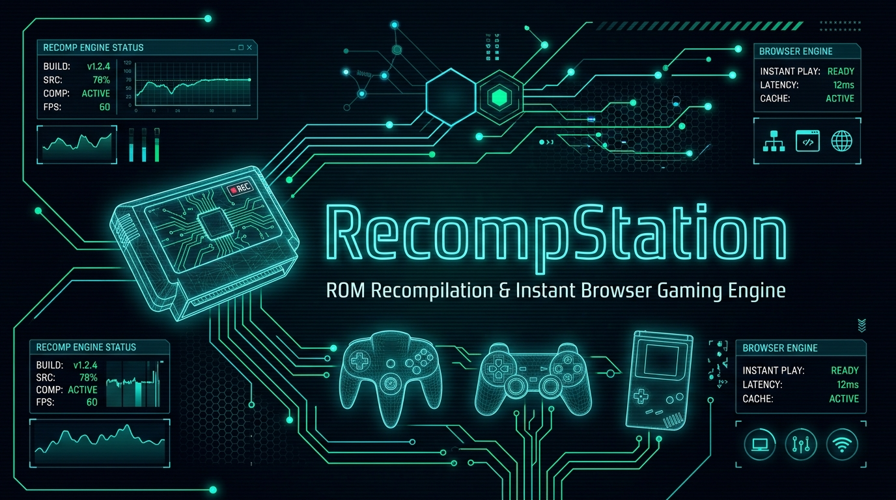

<p align="center">
  
</p>

<h1 align="center">RecompStation</h1>

<p align="center">
  <strong>Next-Generation Static ROM Recompilation, Binary Analysis & Instant WebAssembly Gaming Platform</strong>
</p>

<p align="center">
  <a href="https://github.com"></a>
  <a href="https://github.com"></a>
  <a href="https://github.com"></a>
  <a href="https://github.com"></a>
  <a href="https://github.com"></a>
  <a href="https://github.com"></a>
</p>

---

## 🌟 Executive Overview

**RecompStation** transforms how classic and retro games are analyzed, recompiled, and played. Rather than treating ROMs as opaque blobs for generic emulation, RecompStation acts as an intelligent game-engineering workbench:

1. **Upload Game ROMs**: Drag and drop `.nes`, `.gb`, `.gbc`, `.ch8`, `.z64`, `.n64`, `.sfc`, `.smc`, `.bin` or `.zip` archives.
2. **Deep Binary & Entropy Analysis**: Automatically extracts header metadata, calculates cryptographic checksums (CRC32, MD5, SHA-1), profiles Shannon entropy, and disassembles instructions across multiple architectures (MOS 6502, Sharp SM83, CHIP-8, MIPS R4300i).
3. **Intelligent Recompilation Matrix**: Investigates static recompilers (e.g., N64Recomp, Zelda64Recomp, native C source ports) versus high-performance WebAssembly emulation cores.
4. **Instant In-Browser Gaming**: Play games instantly with zero installation, full gamepad support, audio synthesis, and real-time hardware telemetry.
5. **REA (Reverse Engineer Anything) AI Assistant**: Integrated Gemini-powered reverse engineering agent providing architectural breakdowns, function decompilation analysis, and code reconstruction.
6. **AI Box Art Studio**: Restores vintage box art or generates period-accurate 3D retro box renders from ROM metadata.

---

## 📥 Download Windows Executable (`.exe`)

RecompStation is available both as a web application and as a standalone native Windows desktop application with full hardware acceleration, low-latency audio, and zero-configuration gamepad support.

### Option 1: Direct Download from GitHub Releases (Recommended)
1. Navigate to the **[Releases](../../releases)** page in this GitHub repository.
2. Under the latest release, download your preferred binary:
   - **`RecompStation Setup *.exe`**: Standard Windows installer (NSIS) with Start Menu and Desktop shortcuts.
   - **`RecompStation *.exe`**: Standalone portable edition. No installation required—run directly from anywhere or a USB drive.
3. Verify file integrity using the provided `SHA256SUMS.txt`.

### Option 2: Download Artifact from Any GitHub Actions Run
Every commit to the repository triggers the CI/CD pipeline which automatically produces fresh `.exe` binaries:
1. Click the **Actions** tab at the top of the GitHub repository.
2. Select the latest **"Build Windows Executable (.exe)"** workflow run.
3. Scroll down to the **Artifacts** section at the bottom.
4. Download **`RecompStation-Windows-Binaries`** (ZIP archive containing the installer, portable `.exe`, and checksums).

### Option 3: Trigger a Custom Build via GitHub Actions
You can generate a fresh `.exe` build on demand without touching code:
1. Go to **Actions** → **"Build Windows Executable (.exe)"**.
2. Click **Run workflow** dropdown on the right.
3. Enter your desired version tag (e.g., `v1.0.0`) and leave `create_release: true`.
4. Click **Run workflow**. Within ~3–4 minutes, your Windows `.exe` installer and portable binary will be compiled and published under GitHub Releases.

---

## 🚀 Automated GitHub Deployment (GitHub Pages)

The repository includes a ready-to-run GitHub Actions deployment workflow (`.github/workflows/deploy.yml`).

### Setup in 3 Simple Steps:
1. Push your repository to GitHub.
2. In your GitHub repository, navigate to **Settings** → **Pages**.
3. Under **Build and deployment** → **Source**, select **GitHub Actions**.

Whenever you push to the `main` branch, GitHub Actions automatically:
- Checks out the codebase on an Ubuntu runner.
- Installs dependencies using clean `npm ci`.
- Compiles the production build with Vite (`npm run build`).
- Deploys the static client to GitHub Pages with instant HTTPS and global CDN delivery.

---

## 🕹️ Supported Platforms & Recompilation Engine Matrix

| Platform | Format Extensions | Execution Engine | Static Recompilation Support |
| :--- | :--- | :--- | :--- |
| **Nintendo Entertainment System (NES)** | `.nes`, `.nes.zip` | Custom WebAssembly Cycle-Accurate Core | Direct 6502 Decompilation / Native C Recomp |
| **Game Boy / Game Boy Color** | `.gb`, `.gbc`, `.zip` | Custom Pure JS / Wasm SM83 Core | Static Disassembly & Source Port Rebuilding |
| **Nintendo 64** | `.z64`, `.n64`, `.v64` | Wasm Core / Static Recomp Pipeline | **N64Recomp**, Zelda64Recomp, Ship of Harkinian, SM64 Port |
| **CHIP-8 / Super-CHIP** | `.ch8`, `.ch8.zip` | High-Speed Micro-Interpreter | Native C / Wasm JIT Translation |
| **Super Nintendo (SNES)** | `.sfc`, `.smc` | Multi-Core Wasm Pipeline | Snes9x Wasm / SMW Decompilation |
| **Sony PlayStation (PS1)** | `.bin`, `.cue`, `.iso` | Hardware Accelerated WebGL/Wasm | DuckStation Wasm / Psy-Q Static Recomp |

---

## 📊 Real-Time Hardware Performance Telemetry HUD

RecompStation features a built-in `PerformanceMonitor` telemetry HUD overlay inside the gaming view:

- **High-Frequency FPS & Frame Time**: Driven by `requestAnimationFrame` measuring exact millisecond frame deltas.
- **Microsecond Frame Pacing Sparkline**: Real-time 24-sample histogram visualizes stutter, frame drops, and VSync pacing.
- **Browser Memory Heap Monitor**: Real-time heap consumption tracking via `performance.memory` with graceful fallbacks.
- **Corner Cycling & Visibility Toggle**: Switch between HUD overlay positions or press `F3` (or click `HUD ON/OFF`) to toggle visibility.

---

## 🔒 Security, Privacy & Local-First Architecture

- **100% Local-First Ingestion**: Your ROMs are parsed, hashed, and executed entirely inside your browser's sandboxed client runtime. No game binaries are ever transmitted to external servers.
- **Zero In-Game Telemetry**: No third-party trackers, analytics, or surveillance scripts.
- **Safe Server Proxying**: Gemini AI API interactions (reverse engineering analysis and box art generation) run exclusively through secure server endpoints without exposing credentials to the client.

---

## 🛠️ Local Development & Manual Building

### Prerequisites
- Node.js 20 or higher
- npm 9 or higher

### Installation & Development Server
```bash
# Clone the repository
git clone https://github.com/your-username/recompstation.git
cd recompstation

# Install dependencies
npm install

# Start development server on port 3000
npm run dev
```

Open [http://localhost:3000](http://localhost:3000) in your web browser.

### Building Web Production Bundle
```bash
npm run build
```
The compiled static assets are output to `dist/`.

### Building Standalone Windows `.exe` Locally
If you have a Windows machine (or Wine configured on Linux/macOS):
```bash
# Build web assets and package Windows NSIS installer + Portable executable
npm run dist:win
```
The generated `.exe` files will be saved in the `release/` folder:
- `release/RecompStation Setup 0.0.0.exe`
- `release/RecompStation 0.0.0.exe`

---

## 📁 Repository Structure

```text
├── .github/
│   └── workflows/
│       ├── deploy.yml             # Automated GitHub Pages CI/CD
│       └── build-executable.yml   # Windows .exe packaging & release automation
├── electron/
│   └── main.cjs                  # Electron main process with WebGL & Wasm flags
├── public/
│   ├── github-banner.jpg         # High-resolution repository banner
│   └── favicon.ico               # Application retro icon
├── src/
│   ├── assets/                   # Vector and raster assets
│   ├── components/               # UI components (RomUpload, PlayerModal, PerformanceMonitor, etc.)
│   ├── engines/                  # Core engines (NesEngine, GameBoyEngine, Chip8Engine, WasmRunner)
│   ├── services/                 # Binary parser, checksums, entropy, disassembler, REA agent
│   ├── App.tsx                   # Main platform application layout and routing
│   └── main.tsx                  # Application bootstrap
├── server.ts                     # Full-stack Express server with Gemini AI proxy
├── package.json                  # Dependencies, scripts, and electron-builder configuration
└── vite.config.ts                # Vite configuration with Tailwind CSS v4
```

---

## ⚖️ Legal Disclaimer

*RecompStation is an educational and analytical research software platform designed to facilitate binary analysis, static recompilation research, and the preservation of digital interactive media. Users are solely responsible for ensuring they possess legal rights or physical backup copies of any ROM files or software executed. RecompStation is an independent open-source project and is not affiliated with, authorized, endorsed, or sponsored by Nintendo Co., Ltd., Sony Interactive Entertainment, or any of their affiliates.*

---

<p align="center">
  Crafted with ❤️ for retro computing preservation and high-performance WebAssembly engineering.
</p>
